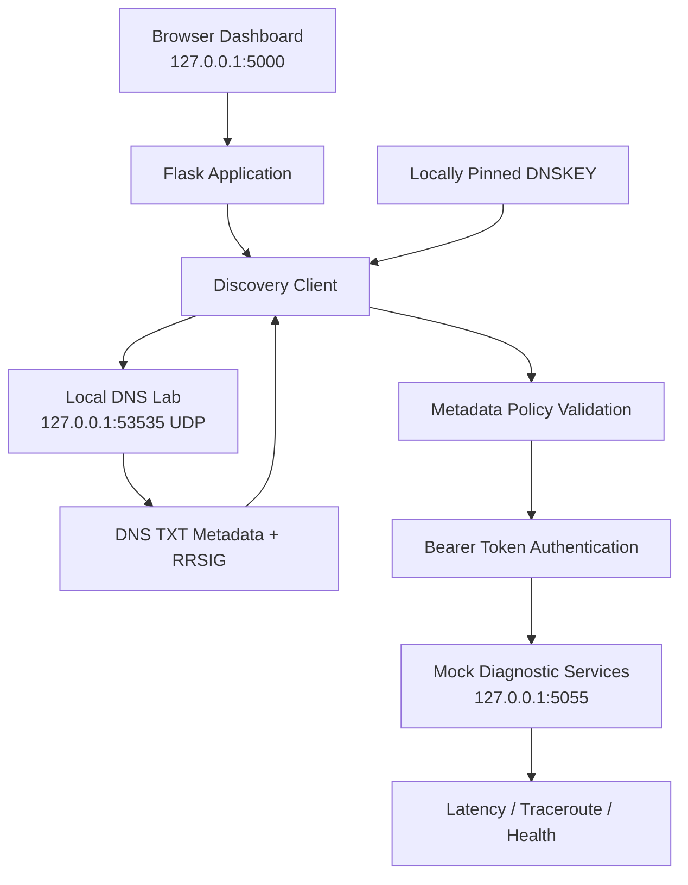

# PS-033 — DNS-Based Discovery of Diagnostic Services

A Python-based educational prototype demonstrating secure discovery of diagnostic services through DNS TXT metadata, DNSSEC signature verification against a locally pinned DNSKEY, metadata policy validation, and authenticated HTTP invocation.

**Project goal:** Allow clients to discover diagnostic service endpoints dynamically instead of hardcoding their locations, while verifying the integrity of discovery metadata before invoking a service.

> **Scope:** This is a controlled localhost educational lab, not production DNS infrastructure. It does not implement the public DNS root-to-zone DNSSEC chain. Latency and traceroute results are simulated. The bearer token is a public demo credential and must never be reused.

## Features

- Three discoverable mock diagnostic services: latency, traceroute and health.
- DNS TXT metadata served by a local UDP DNS responder.
- RRSIG verification using a locally pinned DNSKEY trust anchor.
- Metadata schema validation and strict localhost endpoint allowlisting.
- Bearer-token authenticated HTTP service invocation.
- Interactive browser dashboard with a visible verification pipeline.
- Five live security scenarios with individual results.
- Quantitative dashboard metrics for total scenarios, passed checks, failed checks, security scenarios and detected/rejected scenarios.
- Automated pytest checks.
- Windows-friendly setup instructions.

## Verification Pipeline

Every service discovery follows these stages:

1. **DNS lookup:** Retrieve the diagnostic service's DNS TXT metadata and RRSIG.
2. **DNSSEC signature verification:** Verify the TXT RRset signature using the locally pinned DNSKEY.
3. **Metadata validation:** Check required fields, authentication method and approved local endpoint policy.
4. **Service authentication:** Send a bearer token to the discovered service.
5. **Service invocation:** Call the diagnostic endpoint and display its response.

If a verification or invocation stage fails, the dashboard displays the error and indicates which later stages were blocked.

## Security Test Scenarios

The dashboard's **Run complete security suite** button executes five live scenarios:

| Scenario | Expected behavior |
|---|---|
| Valid discovery and invocation | Accept |
| Bogus DNSSEC signature | Reject |
| Malformed DNS metadata | Reject |
| Invalid bearer token | Reject |
| Unavailable service endpoint | Reject |

The dashboard reports:

- Total scenarios executed.
- Passed scenarios.
- Failed scenarios.
- Number of security-negative scenarios.
- Number of security-negative scenarios detected and rejected.

A scenario is counted as passed only when the observed behavior matches the expected behavior. These dashboard scenarios are separate from the automated pytest test count.

## Requirements

- Windows 10/11, macOS or Linux.
- Python 3.11 or newer.
- Available local ports:
  - `5000` — Flask dashboard.
  - `5055` — Mock diagnostic services.
  - `53535/UDP` — Local DNS lab.

## Quick Start — Windows

Open PowerShell in the project directory.

Create and activate a virtual environment:

```powershell
py -3 -m venv .venv
.\.venv\Scripts\Activate.ps1
```

Install dependencies:

```powershell
python -m pip install --upgrade pip
python -m pip install -r requirements.txt
```

Generate the local DNSSEC signing key and trust anchor:

```powershell
python setup_lab.py
```

Start the application:

```powershell
python app.py
```

Open the dashboard:

**http://127.0.0.1:5000**

Keep the PowerShell terminal open while using the dashboard.

### If PowerShell blocks virtual environment activation

You can run the virtual environment's Python interpreter directly:

```powershell
.\.venv\Scripts\python.exe -m pip install -r requirements.txt
.\.venv\Scripts\python.exe setup_lab.py
.\.venv\Scripts\python.exe app.py
```

## Quick Start — macOS / Linux

```bash
python3 -m venv .venv
source .venv/bin/activate
python -m pip install --upgrade pip
python -m pip install -r requirements.txt
python setup_lab.py
python app.py
```

Open **http://127.0.0.1:5000** in your browser.

## Run Automated Tests

With the virtual environment activated and generated keys present:

```bash
python -m pytest -v
```

The automated pytest suite checks the project's implemented discovery, validation and service behavior.

The dashboard also provides a separate live security test suite that exercises the DNS-to-HTTP flow.

## Demo Workflow

1. Start the application and open the dashboard.
2. Run the Latency Probe, Traceroute Probe and Health Check.
3. Observe the DNS lookup, signature verification, metadata validation, authentication and invocation stages.
4. Select **Test bogus signature** and run a service. The invalid signature should be rejected.
5. Select **Test malformed metadata** and run a service. The metadata should be rejected.
6. Select **Test wrong bearer token**. The mock service should reject the request with HTTP 401.
7. Select **Test unavailable endpoint**. Invocation should fail because the endpoint is not listening.
8. Select **Restore normal data** before continuing.
9. Click **Run complete security suite** to execute all five scenarios and view the quantitative results.

## Architecture



## Repository Structure

```text
ps033_dns_discovery/
├── app.py
├── discovery.py
├── dns_lab.py
├── services.py
├── setup_lab.py
├── templates/
│   └── index.html
├── tests/
│   ├── test_core.py
│   └── test_integration.py
├── .github/
│   └── workflows/
├── requirements.txt
├── pytest.ini
├── CONTRIBUTING.md
├── LICENSE
└── README.md
```

## Security Notes and Limitations

- The application binds to loopback addresses for the local demonstration. Do not expose it to a public network.
- The trust anchor is pinned locally. The prototype does not validate the complete public DNSSEC root-to-zone delegation chain.
- The local DNS responder is intentionally minimal and is not a general-purpose authoritative DNS server.
- The demo token is visible in the source and DNS metadata by design. It must not be treated as a production secret.
- The endpoint policy permits only explicitly approved local demo hosts, ports and service paths.
- Redirects are disabled during HTTP invocation.
- Latency and traceroute values are simulated and do not represent actual network measurements.
- Dashboard scenario counts and pytest counts are different measurements.

## Future Deployment Possibilities

The prototype can be extended into a more complete service-discovery platform through:

1. Full DNSSEC validation, including DNSKEY, DS and trust-chain verification.
2. SRV records or other suitable DNS service-discovery records.
3. Production-grade TLS and secure credential management.
4. A properly managed DNS infrastructure instead of the local lab responder.
5. Real diagnostic services and measured network performance.
6. Role-based access control, logging and monitoring.
7. Containerization and deployment to a controlled test environment.
8. Expanded automated security and integration testing.

These are future enhancements and are not claimed as implemented features.

## GitHub Publishing

Before publishing:

- Do not commit generated private keys such as `lab_key.pem`.
- Do not commit generated trust-anchor files such as `trust_anchor.txt`.
- Do not commit `.venv`, access tokens or personal information.
- Keep `.gitignore` in place.
- Run `python setup_lab.py` after cloning the repository to generate fresh local lab keys.

## License

MIT License — see [LICENSE](LICENSE).
